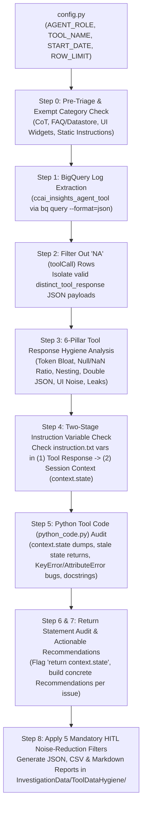

# CXAS Tool Data Hygiene & Code Alignment Skill (`cxas-tool-data-hygiene`)

> **Enterprise-Grade AI Agent Skill for End-to-End Tool Payload Hygiene, Sub-Agent Instruction Alignment, and Python Tool Code Auditing**  
> **Base Knowledge & SOP Source:** [`ToolDataHygiene/Tool_Data_Hygiene_SOP_and_Process_Guide.docx`](file:///usr/local/google/home/kamittt/Documents/New/VZCXAgent/ToolDataHygiene/Tool_Data_Hygiene_SOP_and_Process_Guide.docx)

---

## Table of Contents
1. [Executive Overview: What This Skill Does & Why It Matters](#1-executive-overview-what-this-skill-does--why-it-matters)
2. [Skill Architecture & Folder Structure](#2-skill-architecture--folder-structure)
3. [Single-File Variable Configuration (`config.py`)](#3-single-file-variable-configuration-configpy)
4. [How to Run This Skill (Execution Priority: #1 Natural Language vs. #2 Python CLI)](#4-how-to-run-this-skill-execution-priority-1-natural-language-vs-2-python-cli)
5. [Google Cloud Services, BigQuery Table Schema & SQL Query Used](#5-google-cloud-services-bigquery-table-schema--sql-query-used)
6. [How the Skill Works: The End-to-End SOP Workflow](#6-how-the-skill-works-the-end-to-end-sop-workflow)
7. [Complete Input & Output Files Reference](#7-complete-input--output-files-reference)
8. [Next Manual Steps: Human-in-the-Loop (HITL) Review & Tracker Governance](#8-next-manual-steps-human-in-the-loop-hitl-review--tracker-governance)
9. [Safety, Security & Cloud Write-Isolation Guardrails](#9-safety-security--cloud-write-isolation-guardrails)
10. [Troubleshooting & Complete FAQ Guide](#10-troubleshooting--complete-faq-guide)

---

## 1. Executive Overview: What This Skill Does & Why It Matters

In large-scale conversational AI systems built on **Google Customer Engagement Suite (CXAS / GECX / CES)**, sub-agents rely on backend tools (Python Function Tools, OpenAPI connectors, and Vertex AI Search datastores) to fetch account, billing, order, and device data. When tools return unpruned backend payloads—or dump raw JSON responses directly into session state (`context.state`)—the agent suffers from:
- **Context Window Bloat & High Latency:** Payloads of `15,000–21,000+` characters (~4,000–5,200 tokens per turn) inflate time-to-first-token (TTFT) and LLM inference costs.
- **LLM Reasoning Hallucinations:** Deeply nested JSON (`>3` levels), double-serialized JSON strings (`\"`), `40–60%` empty/null keys, stringified `"NaN"` values, and UI layout noise (`pageLayout`, `carousel`, `quickReplies`) confuse the model.
- **Broken Instruction Routing & Missing Variables:** Discrepancies between the variables referenced in the sub-agent's `instruction.txt` and what is actually returned by `distinct_tool_response` **or** saved in the session context window (`context.state`) cause missing fields or dead-end conversation branches.
- **Session Memory Corruption:** Python tools calling `return context.state` or `context.set_variable("raw_resp", response)` pollute the entire conversation's state memory across sub-agent transfers.

The **`cxas-tool-data-hygiene`** skill automates discovery, measurement, variable cross-checking, and static code analysis across **production BigQuery logs**, **sub-agent instructions (`instruction.txt`)**, and **Python tool definitions (`python_code.py`)**, while enforcing **5 Mandatory Human-in-the-Loop (HITL) Governance Filters** so engineers receive high-signal, actionable recommendations.

---

## 2. Skill Architecture & Folder Structure

```text
VZCXAgent/
├── .agents/skills/cxas-tool-data-hygiene/
│   ├── config.py                         # ⭐ SINGLE POINT OF CONFIGURATION (Update variables here!)
│   ├── SKILL.md                          # Portable LLM Skill instructions (YAML frontmatter + SOP rules)
│   ├── README.md                         # Comprehensive guide & HITL manual workflow (this file)
│   ├── FAQ.md                            # Complete 18-question FAQ guide for new users & reviewers
│   ├── scripts/
│   │   └── run_tool_data_hygiene.py      # Helper engine invoked automatically by the Skill (or via CLI)
│   └── references/
│       └── sop_and_case_studies.md       # Real VZ production case studies & Python DTO templates
│
├── ToolDataHygiene/                      # Base Knowledge, Trackers & Formal Deliverables
│   ├── Tool_Data_Hygiene_SOP_and_Process_Guide.docx
│   ├── VZ_Chat  Hillclimbing Tracker.xlsx
│   └── VZ_ToolData_DetailAnalysis&Recommendation.docx
│
└── InvestigationData/ToolDataHygiene/    # Auto-generated JSON, CSV & Markdown reports per Role/Tool
```

---

## 3. Single-File Variable Configuration (`config.py`)

A core design principle of this skill is **Zero-Hunt Configuration**: **every variable** you need to update before running the skill is located in **one single file**:
- **File Path:** [`.agents/skills/cxas-tool-data-hygiene/config.py`](file:///usr/local/google/home/kamittt/Documents/New/VZCXAgent/.agents/skills/cxas-tool-data-hygiene/config.py)

You **never** need to edit `scripts/run_tool_data_hygiene.py` or `SKILL.md` to change the target role, tool name, date window, or sample size.

### 3.1 Primary Run Variables (Update Before Every Run)

Open [`.agents/skills/cxas-tool-data-hygiene/config.py`](file:///usr/local/google/home/kamittt/Documents/New/VZCXAgent/.agents/skills/cxas-tool-data-hygiene/config.py) and update Section 1:

| Variable Name | Default Value | Purpose & When to Change |
| :--- | :--- | :--- |
| **`AGENT_ROLE`** | `"BYOD"` | Exact sub-agent role name as logged in BigQuery `role` (e.g., `"BYOD"`, `"VZ_Billing_Agent"`, `"Equipment_upgrade"`, `"Activation"`, `"VZ_Account_Mgt"`). |
| **`TOOL_NAME`** | `"get_past_device_byod"` | Exact tool name in BigQuery `tool_call_display_name` / `$.toolResponse.displayName` (e.g., `"get_past_device_byod"`, `"get_addLine_createCart_byod"`, `"addsim_byod"`, `"get_case_activations"`). |
| **`START_DATE`** | `"2026-09-28"` | Start date (`YYYY-MM-DD`) for the BigQuery `DATE(startTimestamp) >= START_DATE` filter. |
| **`ROW_LIMIT`** | `500` | Maximum number of production execution rows (`LIMIT 500`) to pull from BigQuery per tool. |
| **`LOCAL_SUB_AGENT_FOLDER`** | `None` | Leave `None` for automatic resolution. Only set if the local folder name under `agents/` differs from `AGENT_ROLE`. |
| **`OFFLINE_BQ_FILE`** | `None` | Leave `None` for live BigQuery extraction. Set to a local `.json` or `.csv` file path if running offline without `bq` CLI access. |

### 3.2 Environment, Threshold & Exemption Variables (Pre-Configured in `config.py`)

Sections 2–3 of `config.py` come pre-configured with production defaults and rarely need modification:

| Variable Name | Default Value | Description |
| :--- | :--- | :--- |
| `BQ_PROJECT_DATASET_TABLE` | `"conversation-analysis-433113.vz_vcg_wireless_chat_nga.ccai_insights_agent_tool"` | Fully qualified BigQuery table storing CCAI Insights agent & tool logs. |
| `LOCAL_AGENT_APP_DIR` | `"VZAmitLocal/app/Dev_-_Profile_Chat_Agent"` | Local path to the exported CXAS agent codebase (`agents/` and `tools/`). |
| `OUTPUT_DIR` | `"InvestigationData/ToolDataHygiene"` | Local directory where generated JSON, CSV, and Markdown reports are saved. |
| `MAX_RECOMMENDED_CHARS` | `1500` | Payloads above `1,500` chars (~375–400 tokens) are flagged for payload bloat. |
| `COMPACT_CLEAN_CHAR_LIMIT` | `220` | Flat responses `<= 220` chars with no structural defects trigger HITL Filter #3 (`"All good from tool response data hygiene point of view"`). |
| `HIGH_EMPTY_FIELD_RATIO_THRESHOLD` | `0.25` | Flags payloads where `>= 25%` of keys (when total keys `>= 8`) are `""`, `null`, `[]`, or `{}`. |
| `MAX_RECOMMENDED_NESTING_DEPTH` | `4` | Flags JSON structures nested deeper than `4` levels. |
| `EXEMPT_*_TOOLS` | *(4 Pre-configured sets)* | Step 0 Pre-Triage exempt tool categories (CoT tools, FAQ/Datastore search tools, UI Widgets, and Static Prompt-Injection tools). |

---

## 4. How to Run This Skill (Execution Priority: #1 Natural Language vs. #2 Python CLI)

> [!IMPORTANT]
> **Execution Precedence Rule:**  
> **Priority 1 (Primary & Recommended)** is always to run the skill via **Natural Language in your AI Agent Chat**.  
> **Priority 2 (Secondary / Optional Fallback)** is running the underlying Python helper script directly in the terminal when you only need a headless CLI execution.

---

### 🥇 Priority 1 (Primary & Recommended): Run the Skill via Natural Language in Chat

Running the skill via **Natural Language** is the primary, highest-priority method because the AI Agent automatically reads [`SKILL.md`](file:///usr/local/google/home/kamittt/Documents/New/VZCXAgent/.agents/skills/cxas-tool-data-hygiene/SKILL.md), executes the BigQuery data extraction and AST audit behind the scenes, **and** performs deep LLM semantic evaluation (verifying `instruction.txt` variable alignment against both `distinct_tool_response` and `context.state`, inspecting `python_code.py` logic branches, and applying the 5 HITL noise-reduction filters).

#### Method 1A: Natural Language Using Variables Set in `config.py` (Most Common)
1. Open [`.agents/skills/cxas-tool-data-hygiene/config.py`](file:///usr/local/google/home/kamittt/Documents/New/VZCXAgent/.agents/skills/cxas-tool-data-hygiene/config.py) and set `AGENT_ROLE`, `TOOL_NAME`, `START_DATE`, and `ROW_LIMIT`.
2. In your AI Agent chat (Antigravity, Gemini Code Assist, Claude Code, Cursor, etc.), simply type:
   > **"Run the `cxas-tool-data-hygiene` skill using the current variables in `config.py` and give me the analysis and recommendations."**

#### Method 1B: Natural Language with On-the-Fly Prompt Overrides (Without Editing `config.py`)
You can also ask the agent in plain English to analyze any specific Sub-Agent and Tool on the fly:
> **"Use the `cxas-tool-data-hygiene` skill to analyze role `BYOD` and tool `get_past_device_byod` from `2026-09-28` with limit `500`, check which instruction variables are missing from both the tool response and context session, and give me the recommendations."**

#### Method 1C: Using Across Other LLM Agents (Claude Code, Cursor, Windsurf, Copilot)
- **In Claude Code CLI / Cursor / Windsurf:**
  > *"Read `.agents/skills/cxas-tool-data-hygiene/SKILL.md` and `.agents/skills/cxas-tool-data-hygiene/config.py`, run the `cxas-tool-data-hygiene` skill, and give me the complete Tool Data Hygiene analysis and recommendations."*
- **In Web-Only Chat UIs (e.g., Claude Projects / ChatGPT without local terminal access):**
  Upload [`SKILL.md`](file:///usr/local/google/home/kamittt/Documents/New/VZCXAgent/.agents/skills/cxas-tool-data-hygiene/SKILL.md) and [`references/sop_and_case_studies.md`](file:///usr/local/google/home/kamittt/Documents/New/VZCXAgent/.agents/skills/cxas-tool-data-hygiene/references/sop_and_case_studies.md) to your project knowledge, attach the exported tool files (`bq_distinct_tool_responses_latest.json`, `instruction.txt`, and `python_code.py`), and ask the LLM in natural language to run the 6-Step SOP review.

---

### 🥈 Priority 2 (Secondary / Optional): Run via Python CLI in Terminal

If you are running an automated batch script in a terminal or CI/CD pipeline without an interactive LLM chat session, you can invoke the underlying helper script ([`scripts/run_tool_data_hygiene.py`](file:///usr/local/google/home/kamittt/Documents/New/VZCXAgent/.agents/skills/cxas-tool-data-hygiene/scripts/run_tool_data_hygiene.py)) directly from the workspace root (`/usr/local/google/home/kamittt/Documents/New/VZCXAgent`):

```bash
# 1. Run using the variables configured in .agents/skills/cxas-tool-data-hygiene/config.py:
python3 .agents/skills/cxas-tool-data-hygiene/scripts/run_tool_data_hygiene.py

# 2. Override variables via CLI flags without editing config.py:
python3 .agents/skills/cxas-tool-data-hygiene/scripts/run_tool_data_hygiene.py \
  --role "BYOD" \
  --tool "get_past_device_byod" \
  --start-date "2026-09-28" \
  --limit 500

# 3. Re-run analysis offline using a previously saved BigQuery JSON/CSV file (skips live bq query):
python3 .agents/skills/cxas-tool-data-hygiene/scripts/run_tool_data_hygiene.py \
  --role "BYOD" \
  --tool "get_past_device_byod" \
  --offline-file "InvestigationData/ToolDataHygiene/BYOD__get_past_device_byod/bq_distinct_tool_responses_latest.json"
```

---

## 5. Google Cloud Services, BigQuery Table Schema & SQL Query Used

During a Tool Data Hygiene audit, this skill interacts with two primary Google Cloud services and local workspace artifacts:

### 5.1 Google Gemini Customer Experience Agent Studio (CXAS / GECX / CES)
- **What It Is:** Google's conversational AI platform (Customer Engagement Suite) where the VZ Profile Chat Agent (`Dev_-_Profile_Chat_Agent`) is authored, orchestrated, and deployed.
- **How This Skill Uses CXAS Artifacts:**
  - Rather than mutating live cloud resources, the skill inspects the local exported CXAS agent structure under `VZAmitLocal/app/Dev_-_Profile_Chat_Agent/`:
    - **Sub-Agent Instructions:** `agents/<SubAgentName>/instruction.txt` (Step 4 audit of `{@TOOL: <tool_name>}` tags, routing logic, and two-stage variable verification against `distinct_tool_response` and `context.state`).
    - **Sub-Agent Configuration:** `agents/<SubAgentName>/<SubAgentName>.json` (verifying registered `tools` and `childAgents`).
    - **Python Function Tools:** `tools/<ToolName>/python_function/python_code.py` and `tools/<ToolName>/<ToolName>.json` (Steps 5 & 6 static AST + regex audit of `context.state` / `context.set_variable`, `context.get_variable`, docstrings, and `return` statements).
  - **CXAS SCRAPI Linter (`uv run cxas lint`):** Used post-remediation to validate structural compliance (e.g., rule `[T002]` requiring Google-style docstrings on Python tools).

### 5.2 Google BigQuery (Production CCAI Insights Logs Warehouse)
- **What It Is:** Google Cloud's serverless enterprise data warehouse storing production turn-by-turn execution logs exported from Contact Center AI (CCAI) Insights and CXAS.
- **BigQuery Project ID:** `conversation-analysis-433113`
- **BigQuery Dataset:** `vz_vcg_wireless_chat_nga`
- **BigQuery Table:** `ccai_insights_agent_tool`
- **Full Table Identifier:** `` `conversation-analysis-433113.vz_vcg_wireless_chat_nga.ccai_insights_agent_tool` ``

#### Table Schema & Extracted Columns

| Column Name | Data Type | Description & Role in Hygiene Analysis |
| :--- | :--- | :--- |
| `conversationName` | `STRING` | Unique CCAI Insights / CES conversation resource path (`projects/.../conversations/...`) used for trace correlation. |
| `startTimestamp` | `TIMESTAMP` | UTC timestamp when the conversation turn occurred; used for date filtering (`DATE(startTimestamp) >= START_DATE`). |
| `role` | `STRING` | Active sub-agent role that invoked the tool (e.g., `BYOD`, `VZ_Billing_Agent`, `Equipment_upgrade`, `Activation`). |
| `tool_call_display_name` | `STRING` | Populated on `toolCall` rows (`NULL` on `toolResponse` rows where displayName is nested at `$.toolResponse.displayName`). |
| `chunks` | `JSON` | Structured JSON trace object containing either `$.toolCall` or `$.toolResponse` (`displayName`, `id`, `response`, `tool`). |
| **`distinct_tool_response`** *(Derived Column)* | `STRING` | Extracted via `CASE WHEN tool_call_display_name IS NULL THEN TO_JSON_STRING(JSON_QUERY(chunks, '$.toolResponse.response')) ELSE 'NA' END`. Contains `'NA'` on `toolCall` rows and the serialized JSON response string on `toolResponse` rows. |

#### Standardized BigQuery SQL Query (Parameterized from `config.py`)

When the skill runs, it automatically constructs and executes this exact SQL query via `bq query --use_legacy_sql=false --label datacloud:antigravity --format=json` using your `config.py` variables (`AGENT_ROLE`, `TOOL_NAME`, `START_DATE`, `ROW_LIMIT`):

```sql
SELECT
  conversationName,
  startTimestamp,
  role,
  tool_call_display_name,
  chunks,
  CASE
    WHEN tool_call_display_name IS NULL THEN TO_JSON_STRING(JSON_QUERY(chunks, '$.toolResponse.response'))
    ELSE 'NA'
  END AS distinct_tool_response
FROM
  `conversation-analysis-433113.vz_vcg_wireless_chat_nga.ccai_insights_agent_tool`
WHERE
  TO_JSON_STRING(chunks) != '{}'
  AND DATE(startTimestamp) >= '2026-09-28'
  AND role = 'BYOD'
  AND (
    -- Condition: Handle toolCall
    JSON_QUERY(chunks, '$.toolCall') IS NOT NULL
    OR (
      -- Condition: toolResponse must match ToolName list
      JSON_QUERY(chunks, '$.toolResponse') IS NOT NULL
      AND JSON_VALUE(chunks, '$.toolResponse.displayName')
        IN ('get_past_device_byod')))
  AND (
    -- Criteria 1: tool_call_display_name matches ToolName list
    tool_call_display_name IN ('get_past_device_byod')
    OR (
      -- Criteria 2: tool_call_display_name is NULL, check nested toolResponse displayName
      tool_call_display_name IS NULL
      AND JSON_VALUE(chunks, '$.toolResponse.displayName')
        IN ('get_past_device_byod')))
LIMIT 500;
```

### 5.3 Using This Skill with ANY Google CXAS App & Custom BigQuery Schema (Dynamic Schema Support)

This skill is **100% generic and portable across any Google CXAS (Customer Experience Agent Studio) application** and any BigQuery table/column structure. In Section `2.1` of [`.agents/skills/cxas-tool-data-hygiene/config.py`](file:///usr/local/google/home/kamittt/Documents/New/VZCXAgent/.agents/skills/cxas-tool-data-hygiene/config.py#L45-L90), any team building an agent on Google CXAS can pull tool responses from **any BigQuery schema** using **4 Dynamic Schema Modes** (`BQ_SCHEMA_MODE` in `config.py` or `--schema-mode` on the CLI):

| Mode (`BQ_SCHEMA_MODE`) | Use Case | How It Works |
| :--- | :--- | :--- |
| **1. `"auto"`** *(Zero-Config Auto-Detection)* | Point the skill at **any new BigQuery table** without manually mapping column names. | Runs `auto_detect_bq_schema` (`bq show --schema --format=json`) to inspect the table's columns, automatically matches conversation ID (`conversation_id`, `session_id`, `call_id`), timestamp (`timestamp`, `created_at`, `startTimestamp`), agent role (`role`, `agent_name`, or `None`), tool name (`tool_name`, `function_name`, `tool_call_display_name`), and payload (`chunks`, `tool_response`, `response_payload`, `output_json`), and builds the right SQL query automatically. |
| **2. `"flat_columns"`** | BigQuery tables where the **tool name** and **tool response JSON/string** are stored directly in flat columns (no nested `chunks` JSON). | Dynamically builds a clean SQL query against your configured `BQ_COL_TOOL_NAME` and `BQ_COL_PAYLOAD` columns. If the table does not have a sub-agent role column, setting `BQ_COL_AGENT_ROLE = None` automatically skips the role filter. |
| **3. `"ccai_chunks_json"`** *(Default)* | Standard CXAS / CCAI Insights nested JSON schemas (like `chunks` or `turn_payload`). | Uses configurable column names (`BQ_COL_CONVERSATION_ID`, `BQ_COL_TIMESTAMP`, `BQ_COL_AGENT_ROLE`, `BQ_COL_TOOL_NAME`, `BQ_COL_PAYLOAD`) and customizable JSON paths (`BQ_JSON_PATH_TOOL_CALL`, `BQ_JSON_PATH_TOOL_RESP_NAME`, `BQ_JSON_PATH_TOOL_RESP_DATA`). |
| **4. `"custom_sql"`** | Complex schemas requiring `UNNEST(...)`, multi-table `JOIN`s, or custom `WHERE` clauses. | Executes `CUSTOM_BQ_SQL_QUERY` from `config.py` using `{table}`, `{agent_role}`, `{tool_name}`, `{start_date}`, and `{row_limit}` placeholders, and passes the results through `normalize_bq_rows` so all downstream steps (Steps 2–7) work seamlessly. |

#### Example: How Another CXAS Project Team Can Run It

- **Option A: Via Natural Language (Priority 1)**
  > *"Run the `cxas-tool-data-hygiene` skill on BigQuery table `my-gcp-project.my_dataset.agent_tool_logs` using `auto` schema mode for tool `check_order_status`."*

- **Option B: Via `config.py` (or CLI Flags)**
  ```python
  LOCAL_AGENT_APP_DIR      = "MyProject/app/My_CXAS_Agent"
  BQ_PROJECT_DATASET_TABLE = "my-gcp-project.my_dataset.agent_tool_logs"

  # Either let the skill auto-detect the table's columns:
  BQ_SCHEMA_MODE = "auto"

  # Or map custom column names directly:
  BQ_SCHEMA_MODE         = "flat_columns"
  BQ_COL_CONVERSATION_ID = "session_id"
  BQ_COL_TIMESTAMP       = "event_timestamp"
  BQ_COL_AGENT_ROLE      = None              # Set to None if table has no role column
  BQ_COL_TOOL_NAME       = "tool_name"
  BQ_COL_PAYLOAD         = "tool_response_json"
  ```

---

## 6. How the Skill Works: The End-to-End SOP Workflow



1. **Step 0 — Pre-Triage & Exempt Category Check:** Automatically checks if `TOOL_NAME` is an Internal Reasoning tool (`think`, `setCurrentActivities`), Knowledge/Datastore tool (`*_datastore*`), UI Widget tool (`carousel`, `showTemplate`), or Static Instruction/Telemetry tool (`rule_book`, `record_user_feedback`). Also resolves the exact local paths for `instruction.txt` and `python_code.py`.
2. **Step 1 — BigQuery Production Log Extraction:** Executes the read-only SQL query against `conversation-analysis-433113.vz_vcg_wireless_chat_nga.ccai_insights_agent_tool` (or loads `OFFLINE_BQ_FILE`).
3. **Step 2 — Filtering Out `"NA"` (`toolCall`) Rows:** Separates `distinct_tool_response == 'NA'` (`toolCall` request rows) from actual `toolResponse` JSON rows so character, token, and sparsity metrics are never skewed.
4. **Step 3 — 6-Pillar Payload Hygiene Analysis:** Quantifies character/token counts, BPE token estimates, total vs. empty/null/`"NaN"` keys, maximum nesting depth, double-serialized JSON strings (`\"`), UI layout noise, duplicate MDN/MTN keys, mixed key casing, string booleans, currency strings, and exception/prompt leaks.
5. **Step 4 — Two-Stage Sub-Agent `instruction.txt` vs. Tool Response & Context Session Alignment:**
   - Extracts all post-tool variables referenced in `instruction.txt` (`{var}`, `[var]`, bulleted variable lists under `"display only the following variables:"`, backtick/quoted fields, and `IF` conditions).
   - **Check 1:** Checks whether each variable is returned in `distinct_tool_response` / `return {...}`.
   - **Check 2:** If NOT in the tool response, checks whether `python_code.py` saves that variable in the session context window (`context.state[...]` / `context.set_variable(...)`).
   - Outputs an explicit list of **Variables Referenced in `instruction.txt` Missing from BOTH Tool Response AND Context Session** (with closest available key suggestions, e.g., `deviceModel` -> `productName`), plus a full cross-reference table.
6. **Step 5, Step 6 & Step 7 — Python Tool (`python_code.py`), `return` Statement Audit & Actionable Recommendations:** Parses `tools/<ToolName>/python_function/python_code.py` using Python's `ast` module and regex rules to flag `return context.state`, `return <raw_api_var>`, `return json.dumps(...)`, raw API dumps into `context.set_variable(...)`, duplicate `context.state` list storage, stale `context.state.get(...)` returns when `else:` branches don't reset state, unsafe `context.state["key"]` bracket reads (`KeyError`), unsafe `.get(...).isdigit()`/`.strip()` calls (`AttributeError`), `print(request)` credential logging, and missing docstrings (`[T002]`)—and synthesizes **concrete, actionable Recommendations** for every finding in both Section 1 (Tracker Column D) and Section 7 of the report.

---

## 7. Complete Input & Output Files Reference

### 7.1 Input Files & Data Sources

| Input Source | Path / Resource | Purpose |
| :--- | :--- | :--- |
| **1. Skill Configuration File** | [`.agents/skills/cxas-tool-data-hygiene/config.py`](file:///usr/local/google/home/kamittt/Documents/New/VZCXAgent/.agents/skills/cxas-tool-data-hygiene/config.py) | Single source of truth for `AGENT_ROLE`, `TOOL_NAME`, `START_DATE`, `ROW_LIMIT`, and hygiene thresholds. |
| **2. BigQuery Production Table** | `` `conversation-analysis-433113.vz_vcg_wireless_chat_nga.ccai_insights_agent_tool` `` | Source of production `chunks` and `distinct_tool_response` payloads (Step 1 & Step 2). |
| **3. Sub-Agent Instruction File** | `VZAmitLocal/app/Dev_-_Profile_Chat_Agent/agents/<SubAgent>/instruction.txt` | Audited in Step 4 for `{@TOOL: ...}` syntax, typos, and post-tool `<if condition="...">` variable alignment. |
| **4. Sub-Agent Config JSON** | `VZAmitLocal/app/Dev_-_Profile_Chat_Agent/agents/<SubAgent>/<SubAgent>.json` | Audited in Step 0/4 to confirm the tool is declared in the sub-agent's `tools` list. |
| **5. Python Function Tool Code** | `VZAmitLocal/app/Dev_-_Profile_Chat_Agent/tools/<ToolName>/python_function/python_code.py` | Audited in Steps 5 & 6 for `context.set_variable` raw dumps, `return context.state`, bugs, and docstrings. |
| **6. Base SOP Guide** | [`ToolDataHygiene/Tool_Data_Hygiene_SOP_and_Process_Guide.docx`](file:///usr/local/google/home/kamittt/Documents/New/VZCXAgent/ToolDataHygiene/Tool_Data_Hygiene_SOP_and_Process_Guide.docx) | Authoritative SOP defining the 6-step process and HITL governance rules. |

### 7.2 Output Files Generated by the Skill

Every run automatically creates a dedicated subfolder inside [`InvestigationData/ToolDataHygiene/<AGENT_ROLE>__<TOOL_NAME>/`](file:///usr/local/google/home/kamittt/Documents/New/VZCXAgent/InvestigationData/ToolDataHygiene) containing four structured output files:

| Output File | Format | Contents & Usage |
| :--- | :--- | :--- |
| **`bq_distinct_tool_responses_latest.json`** | JSON Array | Exact cleaned rows returned by BigQuery (`conversationName`, `startTimestamp`, `role`, `tool_call_display_name`, `chunks`, `distinct_tool_response`). Enables reproducible offline re-runs via `OFFLINE_BQ_FILE`. |
| **`bq_distinct_tool_responses_latest.csv`** | CSV Table | Tabular export of the BigQuery records for quick spreadsheet inspection or sharing. |
| **`hygiene_metrics_and_ast_audit_latest.json`** | JSON Object | Machine-readable telemetry across Steps 0–6: character/token distributions, empty-key ratios, nesting depth, observed schema keys, `instruction.txt` findings, and `python_code.py` AST/regex findings. |
| **`tool_data_hygiene_report_latest.md`** | Markdown Report | Executive-ready SOP report containing the BigQuery SQL query, Step 2 `NA` filtering table, Step 3 6-Pillar metrics, Step 4 `instruction.txt` snippets, Step 5/6 `python_code.py` findings, and prioritized remediation recommendations. |

---

## 8. Next Manual Steps: Human-in-the-Loop (HITL) Review & Tracker Governance

> **CRITICAL GOVERNANCE REQUIREMENT:**  
> While the LLM and automated script excel at parsing thousands of characters of JSON, calculating token bloat, and scanning `python_code.py` AST trees, **an LLM does not know your current sprint scope, cross-team backend API freezes, or undocumented cross-agent state dependencies.**  
> Therefore, **every LLM-generated report MUST undergo a structured Human-in-the-Loop (HITL) review** before recommendations are logged into the official tracking sheet or implemented in code.

### 8.1 LLM vs. Human-in-the-Loop (HITL) Task Allocation Matrix

| SOP Step | What the Skill / LLM Automates | What the Human Reviewer (HITL) Must Verify & Decide |
| :--- | :--- | :--- |
| **Step 0: Pre-Triage** | Flags whether the tool matches one of the 4 exempt categories. | Confirm whether the tool is actively in scope for the current hillclimbing sprint. |
| **Step 1 & 2: BQ Extraction & `NA` Filtering** | Pulls 20 rows from BigQuery and filters out `distinct_tool_response == 'NA'` rows. | If `0` rows or `100% NA` rows are returned, decide whether to widen `START_DATE` (e.g., 60–90 days) or classify the tool as an async fire-and-forget webhook (`disconnect_webhook`). |
| **Step 3: 6-Pillar Response Hygiene** | Computes token/char counts, empty ratios, nesting depth, double JSON strings, and UI noise. | **Drop** minor cosmetic key-renaming suggestions on already-compact payloads (`<= 800` chars). Approve pruning only when payload bloat or structural defects impact LLM accuracy/latency. |
| **Step 4: `instruction.txt` Alignment** | Detects missing `{@TOOL: ...}` tags, typos (`get_case`), and mismatched `<if condition="...">` variables. | Verify whether an apparently missing variable is populated earlier by a parent agent (`Greeting` / `Customer_identification`) or callback before modifying `instruction.txt`. |
| **Step 5 & 6: `python_code.py` & `return` Audit** | Flags `return context.state`, `return <raw_api_var>`, raw `context.set_variable` dumps, and code bugs. | Verify whether any downstream sub-agent reads a field inside the `context.set_variable` object before pruning keys from session state. |

### 8.2 The 5 Mandatory Post-LLM Human Review Checkpoints (When to Drop or Edit LLM Recommendations)

After reading `<ROLE>_<TOOL>_hygiene_report.md`, apply this 5-point checklist to **accept, edit, or drop** each recommendation:

1. **Checkpoint 1 — Drop Schema Pruning on Exempt Tool Categories:**
   - If the LLM recommends changing the output schema of `think`, FAQ/Datastore search tools (`*_faq`, `search_support_pages`), UI Widgets (`carousel`, `plan_tile_widget`, `get_OrderTile`), or static instruction tools (`get_promo_inquiry_instructions`), **DROP** that recommendation.
2. **Checkpoint 2 — Verify Cross-Agent Session Variable Dependencies (`context.variables` / `context.state`):**
   - Before accepting a recommendation to prune keys inside `context.set_variable("<var_name>", ...)`, run a quick search across `VZAmitLocal/app/Dev_-_Profile_Chat_Agent/agents/` and `tools/` for `<var_name>`. If a transferred child agent (`Billing`, `Equipment_upgrade`, `Payment`) reads `context.get_variable("<var_name>")["someKey"]`, **EDIT** the recommendation to preserve `"someKey"` in the pruned dictionary.
3. **Checkpoint 3 — Drop Over-Engineering on Already-Compact Responses:**
   - If a tool's `distinct_tool_response` is already small (`< 800` characters, e.g., `get_addLine_createCart_byod` returning `{"data": {"newLineNumber": "1"}}`) and works reliably in production, **DROP** any cosmetic suggestions (like renaming `"newLineNumber"` to `"line_number"`). Record the Tool Response Hygiene status simply as:
     > *"All good from tool response data hygiene point of view. No tool response data hygiene recommendation needed."*
4. **Checkpoint 4 — Keep Response Hygiene Separate from Python Code / Instruction Bugs:**
   - Ensure the final recommendation clearly distinguishes between:
     - **(A) Tool Response Data Hygiene** (what the LLM receives in `distinct_tool_response`),
     - **(B) Python Tool Code & Session Context Hygiene** (`python_code.py` `context.set_variable` dumps, `return context.state`, or `AttributeError` bugs), and
     - **(C) Sub-Agent Prompt Alignment** (`instruction.txt` `{@TOOL: ...}` syntax and `<if>` conditions).
5. **Checkpoint 5 — Enforce Backend API Freeze (Wrapper-Only Scope):**
   - If any recommendation implies changing the upstream VZ SOE / OneBot microservice contract, **EDIT** it so the transformation happens strictly inside the CXAS Python Function Tool wrapper (`tools/<ToolName>/python_function/python_code.py`).

### 8.3 Step-by-Step Guide to Updating the Official Project Deliverables

Once you have reviewed and filtered the report in `InvestigationData/ToolDataHygiene/<ROLE>_<TOOL>_hygiene_report.md`, complete these manual steps:

#### Manual Step 1: Update the Master Excel Tracker (`ToolDataHygiene/VZ_Chat  Hillclimbing Tracker.xlsx`)
Open [`ToolDataHygiene/VZ_Chat  Hillclimbing Tracker.xlsx`](file:///usr/local/google/home/kamittt/Documents/New/VZCXAgent/ToolDataHygiene/VZ_Chat%20%20Hillclimbing%20Tracker.xlsx), navigate to the **`Tools Hygiene`** tab, and update the row for the analyzed `Sub-Agent Role` and `Tool Name`:
- **Status:** Set to `Reviewed - Action Needed` (if P0/P1/P2 fixes are approved) or `Reviewed - Clean` (if no changes are needed).
- **Sample `distinct_tool_response`:** Paste 1 representative JSON sample from Section 2 of `<ROLE>_<TOOL>_hygiene_report.md`.
- **Tool Response Hygiene Findings:** Copy the HITL-approved summary from Section 3 (or `"All good from tool response data hygiene point of view"`).
- **Instruction (`instruction.txt`) & Python Code (`python_code.py`) Findings:** Copy the approved Step 4, Step 5, and Step 6 findings (including exact line numbers).
- **Priority / Owner:** Assign `P0` (Critical—e.g., `return context.state`, broken `<if>` condition, `AttributeError`), `P1` (High—raw API dump to `context.set_variable`, missing `{@TOOL: ...}` tag), or `P2` (Medium—missing docstring `[T002]`, redundant `get_variable`).

#### Manual Step 2: Append Approved Deep-Dive to `ToolDataHygiene/VZ_ToolData_DetailAnalysis&Recommendation.docx`
If the tool requires engineering changes, copy the curated executive summary, code diff recommendation, and before/after payload comparison from `<ROLE>_<TOOL>_hygiene_report.md` into [`ToolDataHygiene/VZ_ToolData_DetailAnalysis&Recommendation.docx`](file:///usr/local/google/home/kamittt/Documents/New/VZCXAgent/ToolDataHygiene/VZ_ToolData_DetailAnalysis&Recommendation.docx) for leadership and engineering sign-off.

#### Manual Step 3: Local Code Implementation & CXAS Linter Verification (When Implementing Fixes)
When applying approved fixes to the local CXAS agent codebase (`VZAmitLocal/app/Dev_-_Profile_Chat_Agent/`):
1. Edit the local `tools/<ToolName>/python_function/python_code.py` and/or `agents/<SubAgent>/instruction.txt`.
2. Run the deterministic CXAS structural linter from the workspace root to verify zero regressions:
   ```bash
   uv run cxas lint --agent-dir VZAmitLocal/app/Dev_-_Profile_Chat_Agent
   ```
3. Run your unit/callback tests or simulation evals before proposing any deployment.

---

## 9. Safety, Security & Cloud Write-Isolation Guardrails

This skill strictly enforces the workspace security policy defined in [`.agents/AGENTS.md`](file:///usr/local/google/home/kamittt/Documents/New/VZCXAgent/.agents/AGENTS.md):
1. **100% Read-Only BigQuery Execution:** The skill only executes `SELECT` queries against `conversation-analysis-433113.vz_vcg_wireless_chat_nga.ccai_insights_agent_tool`. It never runs DDL/DML (`INSERT`, `UPDATE`, `DELETE`, `DROP`, `CREATE`).
2. **Complete Cloud Write Isolation:** The skill never pushes to, modifies, or mutates cloud resources in `conversation-analysis-433113` or the production CES application (`VZ-custom-ccai-external`).
3. **Local-Only File Writes:** All generated JSON telemetry and Markdown reports are written strictly inside the local workspace directory `InvestigationData/ToolDataHygiene/`.
4. **Automatic Resource Attribution:** All `bq query` calls include `--label datacloud:antigravity` and `CLOUDSDK_METRICS_ENVIRONMENT=datacloud.antigravity`.

---

## 10. Troubleshooting & Complete FAQ Guide

For a full 18-question Frequently Asked Questions (FAQ) reference covering onboarding, variable updates, changing output paths, BigQuery `'NA'` rows, cross-LLM execution, and HITL filtering, see:
- **[`FAQ.md`](file:///usr/local/google/home/kamittt/Documents/New/VZCXAgent/.agents/skills/cxas-tool-data-hygiene/FAQ.md)**

### Quick Troubleshooting Highlights
- **Q: BigQuery returned `0` rows for my `AGENT_ROLE` and `TOOL_NAME`. What should I do?**
  - **A:** First, check `START_DATE` in `config.py` and move it back by 7–14 days (e.g., `"2026-09-15"`). Second, verify the exact case-sensitive spelling of `role` and `tool_call_display_name` in BigQuery.
- **Q: How do I change the output folder path (currently `InvestigationData/ToolDataHygiene`)?**
  - **A:** Update `OUTPUT_DIR` on Line 58 of [`config.py`](file:///usr/local/google/home/kamittt/Documents/New/VZCXAgent/.agents/skills/cxas-tool-data-hygiene/config.py#L58), or pass `--output-dir "<path>"` on the command line.
- **Q: How do I run the skill if my local sub-agent folder name under `agents/` is different from the BigQuery `role` name?**
  - **A:** Set `LOCAL_SUB_AGENT_FOLDER = "YourLocalFolderName"` on Line 38 of [`config.py`](file:///usr/local/google/home/kamittt/Documents/New/VZCXAgent/.agents/skills/cxas-tool-data-hygiene/config.py#L38), or pass `--sub-agent-folder "YourLocalFolderName"` on the CLI.

